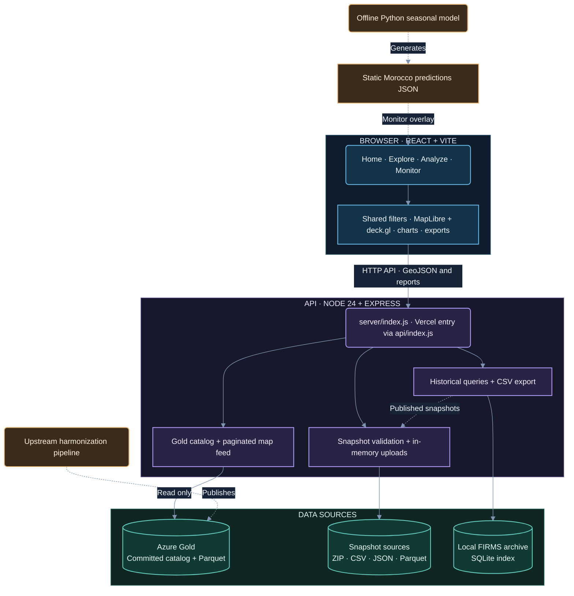

# Project Prometheus

Prometheus is a NASA Space Apps Challenge web app for exploring MODIS and VIIRS active-fire observations and harmonized model results. It brings maps, a burning calendar, historical comparisons, and downloadable reports into one workspace.

## Architecture



MODIS and VIIRS are satellite instruments with different spatial resolutions and overpass times. Prometheus helps researchers and responders compare fire activity without treating the sensors' original counts as directly equivalent. The upstream pipeline produces harmonized data. The web app validates the published records and gives users tools to filter, compare, and export them. Monitor's seasonal overlay comes from the separate [offline Morocco model](server/train-morocco-seasonal.py).

[Run locally](#local-quick-start) · [Try the sample](#try-the-bundled-morocco-zip) · [Find code and API routes](#repository-and-api-guide) · [Troubleshoot](#troubleshooting)

| Route | What you can do |
| --- | --- |
| `/` | Open the project landing page and navigate to each workspace. |
| `/explore/` | Inspect observations on a flat map or 3D globe, select an area, and scrub the timeline. |
| `/analytics/` | Filter by area and date, use the burning calendar and seasonal charts, compare countries, and export matching records. |
| `/monitor/` | Inspect the rolling UTC activity window, use playback, and open the monthly Morocco prediction overlay. |
| `/about/` | Read about the project and its scientific context. |

## Local quick start

1. Install **Node.js 24** with npm and check that `node --version` starts with `v24`. Clone the repository and run `npm ci` from the root so npm installs both workspaces from the root lockfile.

   ```bash
   git clone https://github.com/erwxn/project-prometheus.git
   cd project-prometheus
   npm ci
   ```

2. Start the API from the repository root in the first terminal. Leave it running and open [the health endpoint](http://localhost:5000/health) to check that it returns JSON with `status` set to `ok`.

   ```bash
   npm run server:start
   ```

3. Open a second terminal in the same directory and start Vite. Follow the URL printed by Vite or open [Analyze](http://localhost:5173/analytics/) on the default port.

   ```bash
   npm run client:dev
   ```

### Try the bundled Morocco ZIP

You can follow this walkthrough without Azure credentials. Explore and Analyze try Azure Gold at startup, so you may see a connection error before you load a local sample.

1. In Analyze, go to **Region and filters**, click **Load harmonized results**, and choose [`test-data/harmonized/delivery_2014_morocco.zip`](test-data/harmonized/delivery_2014_morocco.zip) from the cloned repository. You can upload the ZIP directly. In Explore, the same control is under **Dataset and custom dates**.
2. Check the banner and the **Predicted cells** total. Before setting an area or selecting a day, expect **117 model-selected cells from 444 candidates**. The full delivery contains **59 fire groups**.
3. Open the **Burning activity calendar**, choose a day with activity, and watch the map and totals update. Use **Clear selected day** to return to the full date range.
4. Choose **Download search CSV** to export the current selection. With the full range and no area or day filter, the CSV should contain 117 data rows. The ZIP represents historical model output. Try **Use simulated history** for a multi-year example. From the uploaded view, choose **Restore server dataset** to switch back to Gold.

For a standalone check of `/api/v1/fires`, stop the API and run `npm run harmonized:preview` in its place. Open [the snapshot endpoint](http://localhost:5000/api/v1/fires) and look for `metadata.preview` and `metadata.predicted_cells`. The [delivery guide](docs/harmonized-delivery.md) explains the ZIP schema and counting rules.

## Data sources

| Source | What it contains | How to use it |
| --- | --- | --- |
| **Azure Gold · Morocco** | Verified catalog of historical MODIS and VIIRS observations, model candidates, fire groups, aggregates, and evaluation data. | Default source for the Explore and Analyze maps. Configure server-side access with the [Gold backend handoff](deploy/BACKEND_CONNECTION.md). See the [Gold API contract](docs/gold-backend.md) for endpoints and filters. |
| **Harmonized publications** | Validated ZIP, CSV, JSON, or Parquet snapshots, including the bundled 2014 Morocco sample. | Use **Load harmonized results** for a session preview, or configure a publication with the [feed guide](docs/harmonized-feed.md). |
| **Raw NASA FIRMS** | Satellite hotspot records, including a separate local SQLite archive. | Use **Upload MODIS CSV** for a browser session. To prepare the indexed archive, follow the [archive guide](HISTORICAL_ARCHIVE.md). |
| **Simulated history** | Synthetic 2021–2025 examples for testing the calendar, filters, and comparisons. | In local development, choose **Use simulated history** in the dataset controls. |

Supported temporary uploads are capped at 3 MiB and 50,000 records. Uploads are processed in memory for the current session. The MODIS parser expects `latitude`, `longitude`, `acq_date`, `acq_time`, `satellite`, `confidence`, and `frp`. The server also accepts a local CSV at `server/data/modis.csv` or via `FIRES_CSV_PATH` for the snapshot endpoint.

The app counts records according to their source. A **hotspot detection** records heat observed by a sensor. A **predicted cell** is a model-selected grid cell. A **fire group** combines records from one satellite pass. **Fire radiative power (FRP)** is measured in megawatts and describes the rate of energy released. Gold scores are uncalibrated model outputs. Dates with unknown satellite coverage are shown as gaps. See the [analytics guide](FIRE_ANALYTICS.md) and [historical query and export contract](docs/historical-delivery.md) for the interpretation rules.

## Repository and API guide

| Directory | Start here |
| --- | --- |
| `client/` | [`DashboardApp.tsx`](client/src/DashboardApp.tsx) chooses the workspace, [`DashboardProvider.tsx`](client/src/DashboardProvider.tsx) stores research selections, and [`FireMap.tsx`](client/src/FireMap.tsx) renders the map. |
| `server/` | [`index.js`](server/index.js) starts Express, [`gold-routes.js`](server/gold-routes.js) exposes Gold, and [`history-routes.js`](server/history-routes.js) handles historical searches and exports. |
| `shared/` | [Country geometry](shared/README.md) used by the browser and backend geographic filters. |
| `api/` and `deploy/` | The [Vercel entry point](api/index.js) and the [Gold backend handoff](deploy/BACKEND_CONNECTION.md). |
| `test-data/` | [Sample datasets](test-data/README.md) for local development and regression checks. |

| Request | Purpose |
| --- | --- |
| `GET /health` | Confirm that the API process is serving requests. |
| `GET /api/gold/catalog` and `GET /api/gold/explorer` | Inspect committed Gold metadata and retrieve paginated Morocco map points. |
| `GET /api/v1/fires` | Read the configured snapshot, local import, or demo data, depending on server settings. |
| `POST /api/v1/fires/upload` and `POST /api/v1/fires/upload-harmonized` | Validate a session-only MODIS CSV or harmonized dataset. |
| `POST /api/v1/history/query` and `POST /api/v1/history/export.csv` | Query or export a historical selection. |

See the [Gold API contract](docs/gold-backend.md#endpoints) for record schemas, pagination, and evaluation endpoints.

## Checks

From the repository root, use the same checks as [GitHub Actions](.github/workflows/ci.yml).

```bash
npm run lint:secrets
npm --prefix client run lint
node --test client/tests/*.test.mjs server/*.test.js
npm run build
node -e "require('./server/index.js')"
```

For data-specific checks, use `npm run harmonized:check -- test-data/harmonized/delivery_2014_morocco.zip` or `npm run gold:check -- --offline`. The [Gold handoff](deploy/BACKEND_CONNECTION.md#local-commands) describes catalog-only and authenticated checks.

## Troubleshooting

| Symptom | What to check |
| --- | --- |
| npm reports `EUSAGE` or missing lockfile entries | Use Node 24 and run `npm ci` from the directory that contains the root `package-lock.json`. |
| Analyze cannot reach the API | Open [the health endpoint](http://localhost:5000/health) and confirm the server is still running. Use the URL Vite printed for the frontend. |
| Gold returns HTTP 503 | Upload the bundled ZIP for a local preview, or follow the [Gold handoff](deploy/BACKEND_CONNECTION.md) to configure authorized read-only access on the server. |
| The API returns HTTP 429 | The API has rate-limited requests. Wait for the `Retry-After` interval before retrying. |
| The sample total is lower than 117 | Clear the selected day and area, restore the delivery's full date range, and select **Harmonized** as the sensor. |

## Deploy on Vercel

Use the repository root and the **Other** framework preset. [`vercel.json`](vercel.json) installs with `npm ci`, serves `client/dist`, and routes API requests through [`api/index.js`](api/index.js). The production client uses the site's own API origin by default.

Keep credentials on the server. Follow the [Azure Gold deployment instructions](deploy/BACKEND_CONNECTION.md#existing-vercel-project) to connect the current Explore and Analyze maps. The [Vercel hosting guide](docs/vercel-hosting.md) covers the snapshot endpoint and the historical fixture. The local FIRMS SQLite archive is excluded from the hosted bundle.
