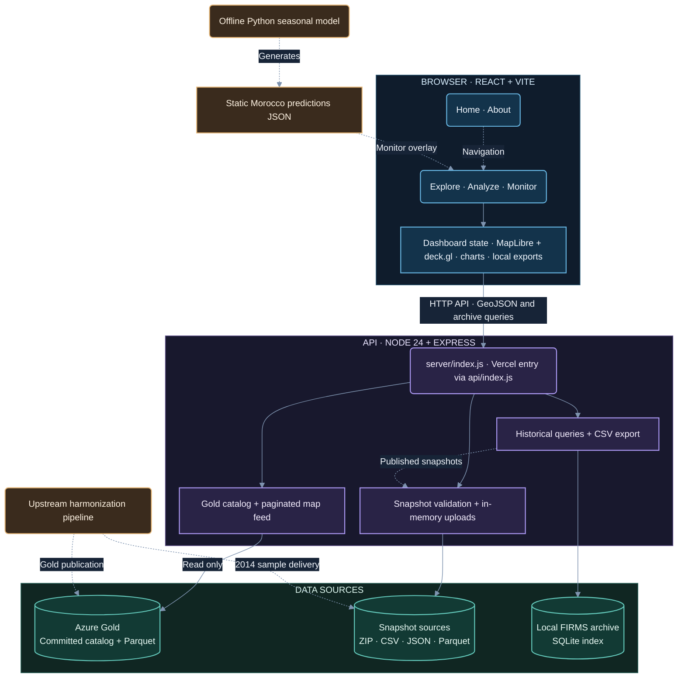

# Project Prometheus

Prometheus is a NASA Space Apps Challenge web app for exploring MODIS and VIIRS active-fire observations and harmonized model results. It brings maps, a burning calendar, historical comparisons, and downloadable reports into one workspace.

## Architecture



NASA FIRMS distributes active-fire products at approximately **1 km for MODIS** (Terra and Aqua) and **375 m for VIIRS** (Suomi NPP, NOAA-20, and NOAA-21). VIIRS can detect smaller hotspots, and different overpass times can capture different stages of a fire. A change in raw hotspot counts can reflect a change in the observing system. [NASA FIRMS active-fire products](https://firms.modaps.eosdis.nasa.gov/map/index.html) · [NASA VIIRS product description](https://firms.modaps.eosdis.nasa.gov/content/descriptions/FIRMS_VIIRS_Firehotspots.html)

The upstream pipeline produces harmonized data. The web app validates the published records and gives users tools to filter, compare, and export them. Monitor's seasonal overlay comes from the separate [offline Morocco model](server/train-morocco-seasonal.py).

[Methods and results](#methods-and-results) · [Judging walkthrough](#judging-walkthrough) · [Run locally](#local-quick-start) · [Find code and API routes](#repository-and-api-guide) · [Troubleshoot](#troubleshooting)

| Route | What you can do |
| --- | --- |
| `/` | Open the project landing page and navigate to each workspace. |
| `/explore/` | Inspect observations on a flat map or 3D globe, select an area, and scrub the timeline. |
| `/analytics/` | Filter by area and date, use the burning calendar and seasonal charts, compare countries, and export matching records. |
| `/monitor/` | Inspect the rolling UTC activity window, use playback, and open the monthly Morocco prediction overlay. |
| `/about/` | Read about the project and its scientific context. |

## Methods and results

### MODIS-to-VIIRS harmonization · 2014 Morocco delivery

1. **Prepare MODIS observations.** The producer used daytime Aqua MODIS C6.1 passes, removed gas flares and static heat sources, and grouped MODIS fire pixels that touched along an edge or corner within a pass.
2. **Estimate VIIRS detections on a finer grid.** The producer used logistic Model B to estimate the probability that VIIRS would detect a hotspot in each 500 m candidate cell on an EPSG:3035 grid. The delivery uses a fire radiative power (FRP) scaling factor of **0.575** for VIIRS-equivalent estimates. Cell FRP is indicative. The group total is the reliable quantity.
3. **Publish and display the selected cells.** The ZIP includes 444 candidate cells from 59 groups and 47 MODIS passes. Express validates the cell records and uses the producer's `detect_f1` flag to select **117 cells**. The flat and partitioned Parquet files contain the same cells, so the reader uses one copy for each year. The map shows cell centres and exports retain their group IDs and model fields.

The producer evaluated the 2014 output against Suomi NPP VIIRS. Among the **116 cells observed by VIIRS**, 18 were positive. At the producer's F1 threshold (approximately **0.167**), precision was **56.5%**, recall was **72.2%**, and F1 was **0.634**. On **12 fully observed fire groups**, mean absolute FRP error fell from **53.03 MW** for raw MODIS to **18.16 MW** after harmonization. These figures describe the evaluated subsets. The method covers daytime passes and can only model candidates generated from MODIS detections. The run and its evaluation are documented in `README_DATA.md` and `accuracy_2014.json` inside the [2014 delivery ZIP](test-data/harmonized/delivery_2014_morocco.zip). The [delivery adapter guide](docs/harmonized-delivery.md#interpretation-and-retained-fields) explains how the web app reads it.

### Azure Gold publication and evaluation

The server resolves the committed Morocco catalog, checks its SHA-256 hash, and verifies each Parquet file's checksum, byte length, row count, and schema before serving it. The browser assembles GeoJSON pages pinned to the same catalog version. Raw MODIS and VIIRS observations, model candidates, and evaluation rows keep their own provenance.

Gold's independent evaluation uses observable candidates with a known VIIRS label and a model score. At the catalog's **0.5** cutoff, 79 eligible rows yielded **4 true positives, 2 false positives, 63 true negatives, and 10 false negatives**. The other 38 evaluation rows had unknown labels and were excluded. Gold scores remain uncalibrated. The upstream producer's full training split and fitting code are outside this web repository. See the [Gold API and scientific contract](docs/gold-backend.md) and the [verification report](deploy/evidence/TEST_RESULTS.md).

### Seasonal baseline on Monitor

Our offline Python model maps historical NOAA-20 VIIRS detections onto a **10 km equal-area grid** clipped to Morocco and counts unique detection cell-days. It smooths historical counts spatially, borrows information from neighbouring months, and blends the result with the annual distribution. Each monthly layer describes the relative location of a detection **given that one occurs**.

We trained on **2019–2023**, used **2024** to choose between the annual and seasonal models, and tested on **2025** after refitting through 2024. On 1,720 held-out detection cell-days, the seasonal model's mean log loss was **6.762** versus **6.779** for the annual baseline and **8.932** for the area-weighted uniform baseline. The 2026 layers use data through 2025. Monitor reads the generated JSON directly. See the [training and backtest script](server/train-morocco-seasonal.py) and its [published output](client/public/data/morocco-predictions.json).

### Analytics and comparisons

Analyze bins records by UTC date and applies the same region, sensor, and date selection to the map, statistics, and search CSV. Mean FRP gives each valid reading equal weight. Periods with no records and unknown coverage stay unknown. The anomaly baseline averages the same month or year over the previous three complete, comparable years. Explore can also display local mean solar time, which it computes from UTC and longitude. See the [analytics methods](FIRE_ANALYTICS.md#scientific-interpretation).

## Judging walkthrough

Prometheus helps users answer three questions for an area they care about: **When is activity usually highest? How does a selected period compare with history? How did two places compare over the same dates?** Follow the [local quick start](#local-quick-start) and try these workflows without cloud credentials.

1. **Inspect the delivered model results.** [Load the 2014 Morocco ZIP](#try-the-bundled-morocco-zip) in Analyze. Check the 117 selected cells, open the burning calendar, and select a day to see the map and statistics update. Use **Download search CSV** to inspect the exported records and their provenance.
2. **Compare seasons and places.** Choose **Use simulated history** to try the month-by-year heatmap and historical comparisons. Select **MODIS**, open **Compare places**, and compare Morocco and Spain from January through December 2025. The simulated series illustrates the controls and comparison rules.
3. **Check how the app handles uncertainty.** Look at the legend and dataset details for coverage, counting units, and source information. An anomaly requires comparable coverage for the selected period and the three prior reference years. Dates with no records and unknown coverage stay visible as gaps.

The bundled delivery covers one historical year in Morocco. The [Azure Gold verification report](deploy/evidence/TEST_RESULTS.md) records which historical observations, predictions, and evaluation datasets were checked independently of the simulated walkthrough.

## Local quick start

1. Install **Node.js 24** with npm and check that `node --version` starts with `v24`. Clone the repository and run `npm ci` from the root so npm installs both workspaces from the root lockfile.

   ```bash
   git clone https://github.com/erwxn/project-prometheus.git
   cd project-prometheus
   npm ci
   ```

2. Start the API from the repository root in the first terminal. Leave it running and open [the health endpoint](http://localhost:5000/health) to check that it returns JSON with `status` set to `ok`.

   ```bash
   npm run server:start
   ```

3. Open a second terminal in the same directory and start Vite. Follow the URL printed by Vite or open [Analyze](http://localhost:5173/analytics/) on the default port.

   ```bash
   npm run client:dev
   ```

### Try the bundled Morocco ZIP

You can follow this walkthrough without Azure credentials. Explore and Analyze try Azure Gold at startup, so you may see a connection error before you load a local sample.

1. In Analyze, go to **Region and filters**, click **Load harmonized results**, and choose [`test-data/harmonized/delivery_2014_morocco.zip`](test-data/harmonized/delivery_2014_morocco.zip) from the cloned repository. You can upload the ZIP directly. In Explore, the same control is under **Dataset and custom dates**.
2. Check the banner and the **Predicted cells** total. Before setting an area or selecting a day, expect **117 model-selected cells from 444 candidates**. The full delivery contains **59 fire groups**.
3. Open the **Burning activity calendar**, choose a day with activity, and watch the map and totals update. Use **Clear selected day** to return to the full date range.
4. Choose **Download search CSV** to export the current selection. With the full range and no area or day filter, the CSV should contain 117 data rows. The ZIP represents historical model output. Try **Use simulated history** for a multi-year example. From the uploaded view, choose **Restore server dataset** to switch back to Gold.

For a standalone check of `/api/v1/fires`, stop the API and run `npm run harmonized:preview` in its place. Open [the snapshot endpoint](http://localhost:5000/api/v1/fires) and look for `metadata.preview` and `metadata.predicted_cells`. The [delivery guide](docs/harmonized-delivery.md) explains the ZIP schema and counting rules.

### Try the Explore timeline and reports

- **24 hours** shows one window. The default UTC window for dated observations includes the latest record. For an imported MODIS CSV, find the editable window start under **Region and research controls**.
- **Full filtered file** spans the dates in the current selection. **Previous 60 min** follows the playback cursor, and **Next detection** jumps to the next timestamp with a matching record.
- **UTC** uses the original acquisition timestamps. **Solar** aligns observations by local mean solar time, calculated as UTC plus longitude divided by 15 hours. Observations with the same solar time at different longitudes may have been acquired at different UTC times.
- **Export PDF** and **Download CSV** use the current Explore map selection. For a complete filtered search across archive pages, use **Download search CSV** in Analyze. **Share this view** saves the selection and camera in a link. Uploaded data files stay in your session.

The map uses OpenFreeMap vector tiles in both themes, and the map theme can be set independently of the interface. See the [Explore implementation guide](docs/explore-features.md) for map and share-link details.

## Data sources

| Source | What it contains | How to use it |
| --- | --- | --- |
| **Azure Gold · Morocco** | Verified catalog of historical MODIS and VIIRS observations, model candidates, fire groups, aggregates, and evaluation data. | Default source for the Explore and Analyze maps. Configure server-side access with the [Gold backend handoff](deploy/BACKEND_CONNECTION.md). See the [Gold API contract](docs/gold-backend.md) for endpoints and filters. |
| **Harmonized publications** | Validated ZIP, CSV, JSON, or Parquet snapshots, including the bundled 2014 Morocco sample. | Use **Load harmonized results** for a session preview, or configure a publication with the [feed guide](docs/harmonized-feed.md). |
| **Raw NASA FIRMS** | Satellite hotspot records, including a separate local SQLite archive. | Use **Upload MODIS CSV** for a browser session. To prepare the indexed archive, follow the [archive guide](HISTORICAL_ARCHIVE.md). |
| **Simulated history** | Synthetic 2021–2025 examples for testing the calendar, filters, and comparisons. | In local development, choose **Use simulated history** in the dataset controls. |

### Import a raw MODIS CSV

Use **Upload MODIS CSV** in the same dataset controls as the ZIP. You can try the [three-row synthetic CSV fixture](client/tests/fixtures/analytics-smoke.csv) first. The parser expects `latitude`, `longitude`, `acq_date` (`YYYY-MM-DD`), `acq_time` (UTC `HHMM`), `satellite` (`T` or `Terra`, `A` or `Aqua`), `confidence` (0–100), and `frp` (nonnegative MW). Invalid rows are counted and excluded. A missing required column or a file with no valid rows is rejected. Raw imports preserve measured FRP.

Temporary uploads are capped at 3 MiB and 50,000 records and are processed in memory for the current session. To use a CSV as the server's snapshot source during local testing, put it at `server/data/modis.csv` or set `FIRES_CSV_PATH` to its absolute path, then restart the API. Read it at `/api/v1/fires`. Explore and Analyze still start with Gold by default.

The app counts records according to their source. A **hotspot detection** records heat observed by a sensor. A **predicted cell** is a model-selected grid cell. A **fire group** combines records from one satellite pass. **Fire radiative power (FRP)** is measured in megawatts and describes the rate of energy released. Gold scores are uncalibrated model outputs. See the [analytics guide](FIRE_ANALYTICS.md) and [historical query and export contract](docs/historical-delivery.md) for the interpretation rules.

## Repository and API guide

| Directory | Start here |
| --- | --- |
| `client/` | [`DashboardApp.tsx`](client/src/DashboardApp.tsx) chooses the workspace, [`DashboardProvider.tsx`](client/src/DashboardProvider.tsx) stores research selections, and [`FireMap.tsx`](client/src/FireMap.tsx) renders the map. |
| `server/` | [`index.js`](server/index.js) starts Express, [`gold-routes.js`](server/gold-routes.js) exposes Gold, and [`history-routes.js`](server/history-routes.js) handles historical searches and exports. |
| `shared/` | [Country geometry](shared/README.md) used by the browser and backend geographic filters. |
| `api/` and `deploy/` | The [Vercel entry point](api/index.js) and the [Gold backend handoff](deploy/BACKEND_CONNECTION.md). |
| `test-data/` | [Sample datasets](test-data/README.md) for local development and regression checks. |

| Request | Purpose |
| --- | --- |
| `GET /health` | Confirm that the API process is serving requests. |
| `GET /api/gold/catalog` and `GET /api/gold/explorer` | Inspect committed Gold metadata and retrieve paginated Morocco map points. |
| `GET /api/v1/fires` | Read the configured snapshot, local import, or demo data, depending on server settings. |
| `GET /api/v1/fires/sample` | Get the illustrative demo payload for API testing. |
| `GET /api/v1/fires/diurnal?hour=HH` | Filter the active snapshot by local mean solar hour (`00`–`23`). |
| `POST /api/v1/fires/upload` and `POST /api/v1/fires/upload-harmonized` | Validate a session-only MODIS CSV or harmonized dataset. |
| `POST /api/v1/history/query` and `POST /api/v1/history/export.csv` | Query or export a historical selection. |

See the [Gold API contract](docs/gold-backend.md#endpoints) for record schemas, pagination, and evaluation endpoints.

## Checks

From the repository root, use the same checks as [GitHub Actions](.github/workflows/ci.yml).

```bash
npm run lint:secrets
npm --prefix client run lint
node --test client/tests/*.test.mjs server/*.test.js
npm run build
node -e "require('./server/index.js')"
```

For data-specific checks, use `npm run harmonized:check -- test-data/harmonized/delivery_2014_morocco.zip` or `npm run gold:check -- --offline`. The [Gold handoff](deploy/BACKEND_CONNECTION.md#local-commands) describes catalog-only and authenticated checks.

## Troubleshooting

| Symptom | What to check |
| --- | --- |
| npm reports `EUSAGE` or missing lockfile entries | Use Node 24 and run `npm ci` from the directory that contains the root `package-lock.json`. |
| Analyze cannot reach the API | Open [the health endpoint](http://localhost:5000/health) and confirm the server is still running. Use the URL Vite printed for the frontend. |
| Gold returns HTTP 503 | Upload the bundled ZIP for a local preview, or follow the [Gold handoff](deploy/BACKEND_CONNECTION.md) to configure authorized read-only access on the server. |
| The API returns HTTP 429 | The API has rate-limited requests. Wait for the `Retry-After` interval before retrying. |
| The sample total is lower than 117 | Clear the selected day and area, restore the delivery's full date range, and select **Harmonized** as the sensor. |

## Deploy on Vercel

Use the repository root and the **Other** framework preset. [`vercel.json`](vercel.json) installs with `npm ci`, serves `client/dist`, and routes API requests through [`api/index.js`](api/index.js). The production client uses the site's own API origin by default.

Set `ENABLE_CSV_UPLOAD=false` on the API to disable both temporary upload endpoints. Build the client with `VITE_ENABLE_CSV_UPLOAD=false` to hide the upload controls.

Keep credentials on the server. Follow the [Azure Gold deployment instructions](deploy/BACKEND_CONNECTION.md#existing-vercel-project) to connect the current Explore and Analyze maps. The [Vercel hosting guide](docs/vercel-hosting.md) covers the snapshot endpoint and the historical fixture. The local FIRMS SQLite archive is excluded from the hosted bundle.
