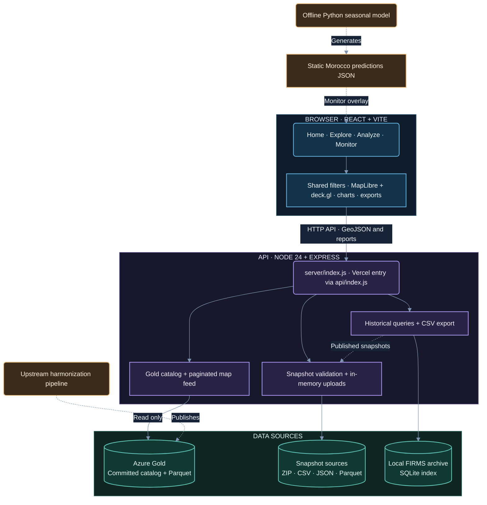

# Project Prometheus

Prometheus is a NASA Space Apps Challenge web app for exploring MODIS and VIIRS active-fire observations and harmonized model results. It brings maps, a burning calendar, historical comparisons, and downloadable reports into one workspace.

## Architecture



The upstream pipeline produces harmonized data. The web app validates the published records and gives users tools to filter, compare, and export them. Monitor's seasonal overlay comes from the separate [offline Morocco model](server/train-morocco-seasonal.py).

| Route | What you can do |
| --- | --- |
| `/` | Open the project landing page and navigate to each workspace. |
| `/explore/` | Inspect observations on a flat map or 3D globe, select an area, and scrub the timeline. |
| `/analytics/` | Filter by area and date, use the burning calendar and seasonal charts, compare countries, and export matching records. |
| `/monitor/` | Inspect the rolling UTC activity window, use playback, and open the monthly Morocco prediction overlay. |
| `/about/` | Read about the project and its scientific context. |

## Local quick start

Install **Node.js 24** with npm. Run the install from the repository root so npm uses the workspace lockfile for both the client and server.

```bash
git clone https://github.com/erwxn/project-prometheus.git
cd project-prometheus
npm ci
```

Start the API and frontend in separate terminals from the repository root.

```bash
npm run server:start
```

```bash
npm run client:dev
```

Open [Analyze](http://localhost:5173/analytics/). The development API defaults to port 5000 and Vite defaults to port 5173.

### Try the bundled Morocco ZIP

In Analyze, open **Region and filters**, click **Load harmonized results**, and pick `test-data/harmonized/delivery_2014_morocco.zip` from the cloned repo. In Explore, the same control is under **Dataset and custom dates**. The sample should show **117 model-selected cells from 444 candidates**, covering **59 fire groups** in the full delivery. Those cells represent historical model output.

Explore and Analyze request Azure Gold on startup. If you are running without Gold credentials, use the upload control to load the sample for the current browser session. For an API-only preview, run `npm run harmonized:preview` in place of `npm run server:start`, then open [the snapshot endpoint](http://localhost:5000/api/v1/fires). See the [delivery guide](docs/harmonized-delivery.md) for the ZIP schema and counting rules.

## Data sources

| Source | What it contains | How to use it |
| --- | --- | --- |
| **Azure Gold · Morocco** | Verified catalog of historical MODIS and VIIRS observations, model candidates, fire groups, aggregates, and evaluation data. | Default source for the Explore and Analyze maps. Configure server-side access with the [Gold backend handoff](deploy/BACKEND_CONNECTION.md). See the [Gold API contract](docs/gold-backend.md) for endpoints and filters. |
| **Harmonized publications** | Validated ZIP, CSV, JSON, or Parquet snapshots, including the bundled 2014 Morocco sample. | Use **Load harmonized results** for a session preview, or configure a publication with the [feed guide](docs/harmonized-feed.md). |
| **Raw NASA FIRMS** | Satellite hotspot records, including a separate local SQLite archive. | Use **Upload MODIS CSV** for a browser session. To prepare the indexed archive, follow the [archive guide](HISTORICAL_ARCHIVE.md). |
| **Simulated history** | Synthetic 2021–2025 examples for testing the calendar, filters, and comparisons. | In local development, choose **Use simulated history** in the dataset controls. |

Supported temporary uploads are capped at 3 MiB and 50,000 records. Uploads are processed in memory for the current session. The MODIS parser expects `latitude`, `longitude`, `acq_date`, `acq_time`, `satellite`, `confidence`, and `frp`. The server also accepts a local CSV at `server/data/modis.csv` or via `FIRES_CSV_PATH` for the snapshot endpoint.

Hotspot detections, predicted cells, and fire groups have different counting units. Gold scores are uncalibrated model outputs. Dates with unknown satellite coverage are shown as gaps. See the [analytics guide](FIRE_ANALYTICS.md) and [historical query and export contract](docs/historical-delivery.md) for the interpretation rules.

## Checks

From the repository root, use the same checks as [GitHub Actions](.github/workflows/ci.yml).

```bash
npm run lint:secrets
npm --prefix client run lint
node --test client/tests/*.test.mjs server/*.test.js
npm run build
node -e "require('./server/index.js')"
```

For data-specific checks, use `npm run harmonized:check -- test-data/harmonized/delivery_2014_morocco.zip` or `npm run gold:check -- --offline`. The [Gold handoff](deploy/BACKEND_CONNECTION.md#local-commands) describes catalog-only and authenticated checks.

## Deploy on Vercel

Use the repository root and the **Other** framework preset. [`vercel.json`](vercel.json) installs with `npm ci`, serves `client/dist`, and routes API requests through [`api/index.js`](api/index.js). The production client uses the site's own API origin by default.

Keep credentials on the server. Follow the [Azure Gold deployment instructions](deploy/BACKEND_CONNECTION.md#existing-vercel-project) to connect the current Explore and Analyze maps. The [Vercel hosting guide](docs/vercel-hosting.md) covers the snapshot endpoint and the historical fixture. The local FIRMS SQLite archive is excluded from the hosted bundle.
